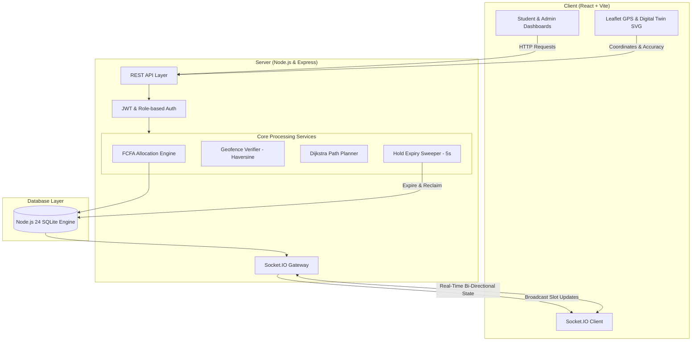

# 🚗 ParkPulse — Smart Campus Parking Management System

[](https://nodejs.org/)
[](https://react.dev/)
[](https://vitejs.dev/)
[](https://sqlite.org/)
[](https://socket.io/)
[](https://tailwindcss.com/)
[](https://leafletjs.com/)

> **ParkPulse** is an end-to-end, real-time smart campus parking allocation platform designed to eliminate parking congestion, prevent spot hoarding, and provide turn-by-turn navigation within campus parking lots.

Built with a high-concurrency **First-Come-First-Allocated (FCFA)** allocation engine, dual-ring **GPS Geofencing**, graph-based **Dijkstra Shortest Path** navigation, and a live **IoT Sensor Digital Twin**.

---

## 📑 Table of Contents

- [Key Highlights](#-key-highlights)
- [System Architecture](#-system-architecture)
- [Core Features](#-core-features)
  - [1. FCFA Allocation & Concurrency Engine](#1-fcfa-allocation--concurrency-engine)
  - [2. Dual-Ring GPS Geofencing](#2-dual-ring-gps-geofencing)
  - [3. Dijkstra Graph-Based Navigation](#3-dijkstra-graph-based-navigation)
  - [4. Real-Time Digital Twin & IoT Simulation](#4-real-time-digital-twin--iot-simulation)
  - [5. Fair Waiting Queue & Offer Windows](#5-fair-waiting-queue--offer-windows)
  - [6. Admin Command Center & Analytics](#6-admin-command-center--analytics)
- [Tech Stack](#-tech-stack)
- [Directory Structure](#-directory-structure)
- [Quick Start Guide](#-quick-start-guide)
  - [Prerequisites](#prerequisites)
  - [Installation & Setup](#installation--setup)
  - [Running the Project](#running-the-project)
- [Demo Credentials](#-demo-credentials)
- [API Reference](#-api-reference)
- [WebSocket Real-Time Events](#-websocket-real-time-events)
- [License](#-license)

---

## 🌟 Key Highlights

- **Zero Blind Circling:** Instant automated allocation to the nearest optimal vacant spot based on vehicle type and entry lane.
- **Race Condition Prevention:** Utilizes atomic SQLite `BEGIN IMMEDIATE` transactions to guarantee that no slot is double-booked even during peak arrival spikes.
- **Fair Anti-Squatting Geofencing:** Employs Haversine distance calculations across two geofence rings (Campus Perimeter & Parking Gate) to prevent students from reserving slots before arriving on campus.
- **3-Minute Dynamic Hold Timer:** Automatically revokes and reallocates reserved slots if the driver does not occupy the spot within the grace period.
- **Lane-Level In-Lot Navigation:** Computes the shortest driving path from the gate entrance through lot lanes directly to the designated slot.
- **IoT Sensor Simulation:** Emulates hardware barrier gates, ultrasonic/magnetic spot occupancy sensors, and fault detection without requiring physical hardware.

---

## 🏗️ System Architecture



---

## ⚡ Core Features

### 1. FCFA Allocation & Concurrency Engine
- Assigns available parking slots using **First-Come-First-Allocated (FCFA)** logic based on strict sequence ticketing.
- Filters slots according to **vehicle classification** (`bike`, `car`, `staff-only`) and zone accessibility.
- Implements an automated **3-minute temporary hold timer**. If the vehicle does not check in, the hold is reclaimed and offered to the next queued driver.

### 2. Dual-Ring GPS Geofencing
- **Ring 1: Campus Boundary (500m radius):** Validates whether the student has physically arrived within university grounds.
- **Ring 2: Parking Gate Area (150m radius):** Restricts active slot allocation requests until the vehicle is physically near the entrance.
- **GPS Accuracy Verification:** Filters out low-accuracy or spoofed GPS readings (rejects accuracy deviations > 50m). Includes built-in mock location toggles for testing.

### 3. Dijkstra Graph-Based Navigation
- Models parking aisles, lane intersections, entrance gate, exit points, and individual parking bays as a weighted directional graph.
- Calculates the optimal route from `entrance` to the allocated parking bay.
- Provides visual turn-by-turn guidance and path highlighting on the parking lot digital map.

### 4. Real-Time Digital Twin & IoT Simulation
- Synchronous 2D visualization of all parking bays across **Zone A (Bikes)**, **Zone B (Cars)**, and **Zone C (Staff Reserved)**.
- Color-coded live status:
  - 🟢 **Available / Free**
  - 🟡 **Held / Reserved (Countdown Active)**
  - 🔴 **Occupied**
  - ⚪ **Maintenance / Blocked**
- **Sensor Simulator:** Trigger arrival events, departures, or toggle maintenance status in real-time to watch instant digital twin updates across all connected clients.

### 5. Fair Waiting Queue & Offer Windows
- When all parking bays are occupied, arriving drivers are queued in strict chronological order.
- When an occupied slot is vacated or a hold expires, the system automatically triggers a **60-second priority offer** to the driver at the head of the queue.

### 6. Admin Command Center & Analytics
- **Live Slot & Zone Management:** Add, block, activate, or reconfigure slot priorities dynamically.
- **Geofence Tuning:** Adjust coordinates, campus boundaries, and gate detection radii directly on an interactive Leaflet map.
- **Analytics & Heatmaps:** Visualize peak arrival times, hourly occupancy trends, vehicle distribution breakdown, and average parking duration using interactive charts (Recharts).
- **Audit Logs:** Full traceability for every allocation, expiry, gate entry, and cancellation.

---

## 💻 Tech Stack

| Layer | Technology | Description |
|---|---|---|
| **Frontend** | React 18, Vite | High-performance SPA with modern component architecture |
| **Styling** | Tailwind CSS, Lucide Icons | Responsive modern UI with clean design system |
| **Animation** | Framer Motion | Smooth state transitions, dialogs, and loaders |
| **Mapping & Visuals** | Leaflet, React-Leaflet | GPS positioning and geofence perimeter visualizations |
| **Charts** | Recharts | Interactive occupancy, dwell time, and peak-hour graphs |
| **Backend** | Node.js, Express 4 | RESTful API server with modular routing and middleware |
| **Real-Time** | Socket.IO | Bi-directional WebSocket communication for live lot syncing |
| **Database** | Node.js 24 SQLite (`node:sqlite`) | Built-in zero-dependency SQLite with WAL mode & atomic transactions |
| **Validation & Security** | Zod, Helmet, Rate-Limit, Bcrypt, JWT | Hardened API security and request schema validation |

---

## 📁 Directory Structure

```text
PARKING/
├── package.json              # Monorepo root scripts (dev, setup, seed)
├── client/                   # Frontend React + Vite application
│   ├── public/               # Static assets & icons
│   ├── src/
│   │   ├── components/       # Digital Twin, Parking Map & Admin Layout
│   │   ├── contexts/         # Auth, Socket.IO & Toast notifications
│   │   ├── lib/              # Axios API clients & Leaflet helpers
│   │   ├── pages/
│   │   │   ├── LandingPage.jsx         # Landing page with live public statistics
│   │   │   ├── LoginPage.jsx           # Role-based credential authentication
│   │   │   ├── admin/                  # Dashboard, Slots, Zones, Geofence, Analytics, Sensors
│   │   │   └── student/                # Student Dashboard, Allocation, Navigation & Queue
│   │   ├── App.jsx           # Route definitions & protected route guards
│   │   └── main.jsx          # React DOM entry point
│   └── vite.config.js        # Vite build configuration
└── server/                   # Backend Node.js Express server
    ├── db/
    │   ├── database.js       # SQLite connection, schema definition & migrations
    │   └── seed.js           # Demo database seed data (users, zones, slots)
    ├── lib/
    │   ├── dijkstra.js       # Shortest path graph algorithm for lot routing
    │   └── geofence.js       # Haversine distance & perimeter boundary logic
    ├── middleware/
    │   └── auth.js           # JWT verification & role authorization guards
    ├── routes/
    │   ├── admin.js          # Admin dashboard, zones, slots & analytics routes
    │   ├── auth.js           # Login, registration, token verification & logout
    │   └── student.js        # Slot requests, geofence check, check-in/out, queue
    ├── services/
    │   └── allocationEngine.js # Core FCFA engine, queue dispatcher & hold timers
    └── index.js              # Express app, Socket.IO gateway & cron jobs
```

---

## 🚀 Quick Start Guide

### Prerequisites
- **Node.js** (v22.0.0 or higher recommended, as server uses the built-in `node:sqlite` module).
- **npm** (v10+).

### Installation & Setup

1. **Clone the repository:**
   ```bash
   git clone https://github.com/Parthasarathy-28/Parking-system.git
   cd Parking-system
   ```

2. **Install all dependencies & seed the database in one command:**
   ```bash
   npm run setup
   ```
   *This command installs root, server, and client dependencies, then populates SQLite with campus zones, slots, and demo accounts.*

   *(Alternatively, run step-by-step)*:
   ```bash
   npm run install:all
   npm run seed
   ```

### Running the Project

Start both the backend server and frontend client concurrently:

```bash
npm run dev
```

- **Frontend Client:** [http://localhost:5173](http://localhost:5173)
- **Backend API Server:** [http://localhost:5000](http://localhost:5000)
- **API Health Check:** [http://localhost:5000/api/health](http://localhost:5000/api/health)

---

## 🔑 Demo Credentials

The database comes pre-seeded with accounts for immediate testing:

| Role | Name | Email | Password | Vehicle |
|---|---|---|---|---|
| **Admin** | Dr. Rajesh Kumar | `admin@parkpulse.edu` | `Admin@123` | N/A |
| **Student** | Arun Krishnamurthy | `arun@student.psg.edu` | `Student@123` | 🏍️ Bike |
| **Student** | Balasubramanian Venkat | `bala@student.psg.edu` | `Student@123` | 🚗 Car |
| **Student** | Priya Sundararajan | `priya@student.psg.edu` | `Student@123` | 🏍️ Bike |
| **Staff** | Prof. Suresh Babu | `suresh@staff.psg.edu` | `Staff@123` | 🚗 Car |

> *Tip: The application runs with **Demo Mode** enabled by default, allowing you to simulate your GPS location at the campus parking gate with a single click.*

---

## 📡 API Reference

### Authentication (`/api/auth`)
- `POST /api/auth/login` — Authenticate user and receive HTTP-only JWT cookie.
- `GET /api/auth/me` — Retrieve current authenticated user profile.
- `POST /api/auth/logout` — Terminate session and clear cookie.

### Student Endpoints (`/api/student`)
- `GET /api/student/dashboard` — Get active allocation, queue state, and category availability.
- `POST /api/student/verify-location` — Validate latitude/longitude against campus geofences.
- `POST /api/student/request-slot` — Submit an atomic FCFA slot reservation request.
- `GET /api/student/navigation/:slotId` — Fetch Dijkstra graph path coordinates from entrance to slot.
- `POST /api/student/confirm-parking` — Check-in and mark slot as occupied upon vehicle arrival.
- `POST /api/student/exit-parking` — Release slot and complete parking session upon departure.
- `POST /api/student/cancel-allocation` — Cancel active hold and release slot to queue.
- `POST /api/student/accept-queue-offer` — Claim offered slot from the waiting queue.

### Admin Endpoints (`/api/admin`)
- `GET /api/admin/dashboard` — System-wide slot counts, active allocations, and queue lists.
- `GET /api/admin/slots` — List all parking bays with real-time operational status.
- `POST /api/admin/slots` — Add a new parking bay to a specific zone.
- `PATCH /api/admin/slots/:id/status` — Modify slot status (`available`, `maintenance`, `blocked`).
- `GET /api/admin/zones` — List parking zones with vehicle types and capacities.
- `GET /api/admin/geofence` — Retrieve current campus and gate geofence parameters.
- `PUT /api/admin/geofence` — Update geofence coordinates and accuracy thresholds.
- `GET /api/admin/analytics` — Fetch peak hour volume, utilization ratios, and event logs.
- `POST /api/admin/sensor-event` — Simulate an IoT sensor trigger (arrival, departure, fault).

### Public Endpoints
- `GET /api/public/stats` — Live availability metrics for landing page visitors.

---

## 🔌 WebSocket Real-Time Events

| Event Name | Direction | Payload | Description |
|---|---|---|---|
| `join:slots` | Client ➔ Server | — | Subscribe to live parking slot updates for the college |
| `slot:updated` | Server ➔ Client | `{ slot, occupancy, operational }` | Broadcasted whenever any slot changes state |
| `allocation:created` | Server ➔ User | `{ allocationId, slotId, expiresAt }` | Sent to specific user when a slot is assigned |
| `allocation:expired` | Server ➔ User | `{ allocationId, slotId }` | Sent when a 3-minute hold expires without check-in |
| `queue:offered` | Server ➔ User | `{ queueId, slotId, expiresAt }` | Sent when a waiting queue driver receives an offer |
| `queue:updated` | Server ➔ User | `{ position, totalWaiting }` | Queue position advancement notice |

---

## 🤝 Contributing

Contributions are welcome! Please follow these steps:

1. Fork the Project repository.
2. Create your Feature Branch (`git checkout -b feature/SmartRecommendation`).
3. Commit your changes (`git commit -m "Add smart parking recommendation"`).
4. Push to the Branch (`git push origin feature/SmartRecommendation`).
5. Open a Pull Request.

---

## 📄 License

This project is open-source and available under the [MIT License](LICENSE).
